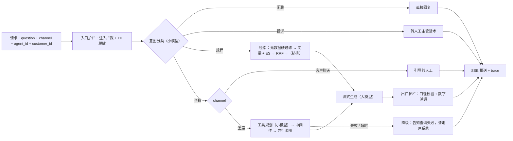

# 开发计划

> 怎么做：现状与目标的差距、数据从哪来、设计、评测口径、阶段顺序。目标和边界见 [GOALS.md](GOALS.md)，每个阶段的任务见 [harness/build/](harness/build/)，实际进度只认 [harness/build-log.md](harness/build-log.md)。
> 第二版（v2），2026-11-18。第一版在 [harness/archive/v1-dify-docs/PLANS.md](harness/archive/v1-dify-docs/PLANS.md)。

## 0. 给执行模型的话

- 开工顺序：`AGENTS.md` → `harness/build-log.md` 的「当前状态」→ `GOALS.md` → 本文件 → 当前阶段的 `harness/build/phase-NN-*.md`。
- 本次是**在现有代码上改造**，不是重写。第一版的代码能跑、测试是绿的；每个阶段结束时 `uv run poe check` 仍要通过。
- 涉及索尼银行的事实（利率、手续费、规程细节）一律以 `data/raw/public/` 里作者保存的页面为准，不要用模型自己的记忆，也不要用本文件里的举例数字。
- 本文件里的设计是起点。和代码事实冲突，或有更简单的做法时，可以改，但要在阶段文件的「记录」和 build-log 里写明原因。

## 1. 技术栈：现状与目标

| 层 | 第一版现状 | 目标 | 动作 |
|---|---|---|---|
| Web | FastAPI，SSE 只推步骤和整段回答 | FastAPI，SSE 逐 token 带序号、可断点续推 | 改 |
| 编排 | LangGraph，五路路由（DIRECT/SINGLE/MULTI/CLARIFY/REFUSE） | LangGraph，意图四分类 + 坐席 / 客户双泳道子图 | 改 |
| 对话状态 | 自写的 `sessions` 表和 `SessionStore` | LangGraph Postgres checkpointer | 换 |
| 向量库 | pgvector（HNSW），Qwen3-Embedding-0.6B | 不变 | 留 |
| 关键词检索 | 内存 bm25s + jieba3（中文） | Elasticsearch + kuromoji（日文） | 换 |
| 融合与精排 | RRF + Qwen3-Reranker-0.6B | RRF 不变；精排保留为开关，默认按延迟预算决定 | 留 |
| 元数据过滤 | `edition`（自部署 / 云版）硬过滤 | 规程类型、产品线、生效 / 失效日期硬过滤 | 泛化 |
| 缓存 | 进程内缓存 | Redis：工具结果 5 秒缓存、流式片段缓冲 | 增 |
| 业务数据 | 无 | 独立的模拟业务系统（FastAPI + MySQL），5 个只读接口 | 增 |
| 工具层 | 无 | 5 个只读工具 + 统一中间件 | 增 |
| 模型接入 | 直连 DeepSeek，单一模型 | 本地模型网关（LiteLLM Proxy，OpenAI 兼容）+ 大小模型分级 | 改 |
| 护栏 | 注入拦截（中文正则） | 入口 PII 脱敏 + 注入拦截；出口口径校验 + 数字溯源 | 改 |
| 观测 | Langfuse 云端 + 本地 `traces` 表 | 不变（自托管 Langfuse 列为可选） | 留 |
| 评测 | 评测器、评审、指标、报告、消融脚本 | 复用框架，换用例集和指标 | 改 |
| 对照 | 无 | 本地自部署 Dify，Chatflow V3 | 增 |

## 2. 现状代码与差距（按文件）

| 位置 | 现在是什么 | 要变成什么 |
|---|---|---|
| `backend/app/orchestration/pipeline.py` | 一张图：护栏 → 独立化 → 路由 → 改写 / 分解 → 检索 → 证据评分 → 生成 → 忠实度校验。一次请求串行 5 次左右模型调用，非流式 | 主链路压成：护栏 → 意图 → 泳道分发 → 工具或检索 → 流式生成 → 出口校验。证据评分、忠实度校验改为可选的严格模式，默认关 |
| `backend/app/prompts/*.md` | 中文、围绕 Dify 文档 | 全部新写日文版（文件名加 `_v2` 或新名，不覆盖旧文件） |
| `backend/app/retrieval/bm25.py`、`terms.py` | bm25s + jieba 分词 + 中文术语保护 | 新增 ES 实现，接口保持「查询 → (chunk_id, 分数) 列表」；旧实现在阶段 32 验证完后删除 |
| `backend/app/retrieval/retriever.py` | 向量与 BM25 并行 → RRF → 精排 → 父块扩展；`editions` 参数做硬过滤 | 结构不动；过滤参数换成 `MetaFilter`（产品线、类型、查询日期） |
| `backend/app/db/tables.py` | `documents.edition` 有 CHECK 约束；`sessions` 表 | 新迁移：文档与块的元数据列；`sessions` 由 checkpointer 的表取代 |
| `backend/app/ingest/` | 读 mdx、去 JSX、父子切块 | 新增 HTML / PDF / Markdown 加载器；切块目标 300～800 字 |
| `backend/app/api/chat.py` | `stream=true` 时推 `step` 和最终 `answer` 事件 | 逐 token `delta` 事件，SSE `id` 为递增序号，支持 `Last-Event-ID` 续推 |
| `backend/app/orchestration/guard.py` | 中文注入正则 | 加日文规则和 PII 脱敏 |
| `backend/app/providers/` | DeepSeek 客户端、本地嵌入与精排、预算、假实现 | 新增走网关的客户端（支持流式和工具调用），按档位取模型；假实现同步补齐 |
| `backend/app/core/cache.py`、`resilience.py` | 缓存、超时、重试、熔断 | 工具中间件复用；缓存后端加 Redis |
| `backend/eval/` | 评测器、评审、指标、报告 | 复用；新增意图、查数、泳道、护栏四类用例的评分 |
| `backend/scripts/fetch_docs.py` 等 | 下载 Dify 文档 | 删除或替换为语料构建脚本 |

## 3. 数据

### 3.1 知识库语料

三层来源，全部不入库，只入库构建脚本、提示词和随机种子。每篇文档带 `source` 字段区分。

| 层 | 内容 | 怎么来 | 规模 |
|---|---|---|---|
| 公开层 `public` | 索尼银行住宅贷款的公开页面：商品说明、手续费、利率与见直规则、还款与条件变更、団信、各类说明书 PDF、住宅贷款 FAQ | **用真实浏览器按清单逐页保存**到 `data/raw/public/`（HTML 或 PDF），由执行模型操作浏览器完成，作者不必手工保存。阶段 31 先列清单（入口 `https://sonybank.jp/products/hl/` 的侧栏约 35 页；FAQ 入口 `https://sonybank.jp/faq/?category=5314`，下分 5 个子类），再按下面的限制保存 | 约 50～200 篇 |
| 内部层 `internal`（合成） | 模拟行内材料：坐席操作手册、应对话术、事务规程、每月适用利率通知。由大模型**以公开层为事实依据**生成，每篇带 `synthetic: true` 和所依据的公开文档 ID | 生成脚本 + 固定提示词；每月利率通知用利率表套模板生成，不调模型 | 约 100～200 篇，其中带新旧版本的至少 30 组 |
| 干扰层 `distractor`（合成） | 其他产品线（外币存款、卡贷、投资信托、日元存款、借记卡等）的规程和 FAQ 风格文档，以及住宅贷款的历史版本 | 模板 + 大模型批量生成；只用于放大语料，不出题 | 补足到合计约 3000 篇 |

约束：

- sonybank.jp 对非浏览器请求返回 403（2026-11-18 实测 `robots.txt` 与页面均如此），利用条件只允许私人使用、禁止再分发。作者 2026-11-18 决定：公开页面由执行模型操作**有界面的真实浏览器**保存，条件如下，任何一条做不到就停下记阻塞：
  - 只取清单里的页面，总数不超过 200；只取不需要登录的公开页面，不点任何申请、登录、交易入口。
  - 一次只开一页，页与页之间至少间隔 5 秒；同一页失败最多重试 1 次。
  - 不用脚本或 HTTP 库直接请求该站，不改 User-Agent 或请求头去冒充浏览器，不处理验证码。
  - 遇到 403、验证码、访问频率提示或登录页，立刻停止，把已保存的清单和停下的位置写进记录。
  - 每页保存时记下 URL、标题、保存时间，写进 `data/raw/public/manifest.jsonl`（不入库）。
- 如果保存到的 FAQ 数量不够，用内部层的合成 FAQ 补，不去找别的办法抓。
- 干扰层的生成费用预估在 ¥15～30（3000 篇短文），超出每日预算的部分分天跑，或由作者手动运行。
- 两档语料：S = 公开层 + 内部层；L = S + 干扰层。入库时用 `corpus_tier` 区分，检索可按档过滤。

### 3.2 文档与块的元数据

| 字段 | 取值 | 用途 |
|---|---|---|
| `source` | `public` / `internal` / `distractor` | 区分来源；报告分开统计 |
| `synthetic` | 布尔 | 合成标记 |
| `product_line` | `home_loan` / `card_loan` / `fx_deposit` / … | 硬过滤 |
| `policy_type` | `rate` / `repayment` / `fee` / `insurance` / `procedure` / `faq` / … | 硬过滤与统计 |
| `policy_id` | 如 `HL-RATE-2026-11` | 同一规程不同版本共用前缀；关键词精确召回 |
| `effective_from` / `effective_to` | 日期，`effective_to` 可空 | **检索前硬过滤**：只留查询日期落在区间内的块 |
| `status` | `draft` / `online` / `offline` | 两阶段发布：先上线新版，再下线旧版 |
| `corpus_tier` | `S` / `L` | 两档规模对比 |

元数据同时写进 PostgreSQL（向量检索的 WHERE）和 ES（filter），两边过滤条件必须一致，由同一个 `MetaFilter` 对象生成。

### 3.3 模拟业务系统（合成数据）

独立服务 `mock_core/`（FastAPI），库用 MySQL 8，和问答服务的 PostgreSQL 分开，模拟「业务库不归我们管」。

- 表：`customers`、`agents`、`agent_customer`（归属关系）、`loan_contracts`、`repayment_schedule`、`repayment_history`、`delinquencies`、`rate_terms`、`benefits`。表里**故意放敏感列**（口座番号、住所、電話番号），用来验证最小字段。
- 种子数据：固定随机种子生成约 300 个客户。要覆盖：35 年期合同（还款计划 420 行，用来复现「返回太大撑爆上下文」）、ペアローン（一人两笔合同）、延滞中、已完济、固定期间即将到期、带部分固定金利特约。
- 5 个只读接口，全部 GET，要求请求头带坐席 ID：

| 工具 | 入参 | 返回（裁剪后给模型的字段） |
|---|---|---|
| `query_loan_contracts` | customer_id | 合同列表：合同号、商品、借入额、放款日、状态 |
| `query_repayment_schedule` | contract_id | 下次还款日与金额、剩余本金、剩余期数；明细默认只给最近 5 期并附 `total`，要更多再按区间查 |
| `query_delinquency` | customer_id | 系统内延滞天数、延滞金额、迟延损害金 |
| `query_rate_terms` | contract_id | 适用利率、金利类型、固定期间到期日、団信种类与加点 |
| `query_benefits` | customer_id | 优惠与活动的适用情况 |

- 故障注入：用环境变量或管理接口设定每个接口的额外延迟、超时比例、5xx 比例，评测时用固定种子复现。

## 4. 设计

### 4.1 双泳道流程

- 意图分类只看「当前问题 + 上一轮意图」，不喂完整历史。分类器输出不合法或置信度低时走保守路由：坐席端按规程处理，并在回答里提示可以改问法。
- 置信度优先用本地小模型的 logprobs；拿不到 logprobs 时不要让模型自报分数当置信度，改用「输出是否合法 + 下游是否空返回」做反证。
- 查数与规程混合的问题（「我这笔能不能提前还、手续费多少」）：意图允许输出主意图加一个可选的次意图，两条支路并行后一起生成。第一版先支持这一种组合，其余组合记为已知缺口。
- 工具规划是**受控的一步**，不是自由 ReAct：小模型用函数调用选工具和参数，最多两轮（先摘要、需要明细再查一次）；互不依赖的工具并行执行。
- 客户聊天泳道在图里**根本不挂工具节点**，而不是靠提示词约束。

### 4.2 工具中间件

所有工具调用经过同一条链，顺序固定，每一环可单测：

1. **鉴权**：校验 `agent_id` 存在且与 `customer_id`（或合同所属客户）有归属关系；不通过直接拒绝，不调下游。
2. **缓存**：键为「工具名 + 入参 + agent_id」，Redis 5 秒。
3. **调用**：统一超时（默认 2 秒）、最多重试 1 次、熔断；复用 `core/resilience.py`。
4. **字段白名单**：每个工具一份白名单，白名单外的字段在进模型前丢弃。
5. **截断**：列表超过上限时截断并附 `total`。
6. **记录**：每次调用的工具名、入参、耗时、结果摘要、是否命中缓存、失败原因写进 trace。

失败语义：超时、5xx 算「失败」，进失败率；鉴权拒绝算「拦截」，单独统计。任一必需工具失败时走降级话术，回答里不许出现任何客户数字。

### 4.3 检索

- ES 索引用 kuromoji 分词（需要装 `analysis-kuromoji` 插件，compose 里用自建镜像），字段：块文本、标题路径、`policy_id`（keyword 类型，精确匹配）、元数据。
- 查询：`MetaFilter` 先过滤，再向量与 ES 并行各取前 30，RRF（k=60）融合取前 20，精排后留前 5，父块扩展后组装上下文。
- 精排在 GPU 上约增加 190 毫秒（第一版实测），是否默认开启由阶段 32 的数据决定：对比开关前后的 Top5 命中率和延迟。
- 查询日期默认取当天；评测用例可以指定日期，用来测「问上个月的利率」这类问题。

### 4.4 流式与断点续推

- 生成节点逐 token 产出；每个 SSE 事件带 `id`（从 1 递增）和 `response_id`。
- 服务端把最近的片段写进 Redis（按 `response_id`，保留到生成结束后 120 秒）。
- 客户端断线后用标准的 `Last-Event-ID` 头重连同一个 `response_id`，服务端从该序号之后补发，客户端按序号去重。
- 出口校验放在流结束后：不通过就发一个 `retract` 事件，用兜底话术替换已显示的内容。这是「先流后校」的取舍，换来首字延迟；阶段 35 里记录撤回发生的比例。
- 每 15 秒发一次注释行做心跳。

### 4.5 护栏

- 入口：注入拦截（补日文规则）；PII 脱敏用规则识别電話番号、口座番号、カード番号、マイナンバー、メールアドレス，替换成占位符后再进模型和日志。
- 出口：
  - 禁用表达清单（断定、承诺审查结果、承诺利率）。
  - **数字溯源**：从回答里抽出金额、日期、利率、天数，逐个在本次工具返回或检索到的块里找；找不到就判不通过。
  - 引用校验：规程类回答必须带引用，引用的块必须在本次检索结果里且处于生效期。

### 4.6 模型网关与分级

- 本地起一个 LiteLLM Proxy 作为「内部 AI 网关」的替身：统一的 OpenAI 兼容入口、按 key 鉴权、限流、记用量。问答服务和 Dify 都只连网关，保证两边用同一组模型、同一套计费口径。
- 小模型档：意图分类、工具规划、追问独立化。使用 Ollama 托管本机 GPU 上的 4B～8B 模型，具体型号在阶段 30 按日文意图准确率和延迟选定；本机带不动时退回 `deepseek-flash`。
- 大模型档：最终生成。用 DeepSeek 较强的型号，经网关调用。
- 现有的每日预算和成本记账保留，记账口径改为按网关返回的 token 数。
- 与目标的偏差要写明：大模型不是私有化部署，是外部 API 的替身。

### 4.7 对话状态

- 用 `langgraph-checkpoint-postgres` 的异步 checkpointer，`thread_id` 等于会话 ID。
- 状态里只放流程需要恢复的东西（消息、上一轮意图、当前客户号）；工具结果这类可重建的热数据放 Redis。
- 验收里要有一条「进程中途被杀，重启后同一会话能继续」的集成测试。

## 5. Dify 对照

- 阶段 37 在本机用官方 compose 自部署 Dify 当前稳定版（版本号写进记录），模型供应商配成「OpenAI 兼容」，指向 §4.6 的网关。分段、混合检索、分类器描述与少样本示例按平台常规配置，配置完成后做完整同题回放。
- 用 Chatflow 搭 V3：开始节点（`query`、`channel`、`customer_id`）→ 问题分类器 → 条件分支 → 知识检索 / HTTP 请求（调 `mock_core`）+ 代码节点（裁剪）→ LLM → 直接回复。知识库导入 S 档语料。
- 执行模型写出可导入的 DSL（YAML）和逐节点配置说明，并操作浏览器在本机 Dify 界面完成导入、建知识库和节点核对（作者 2026-11-18 决定交给执行模型）；每一步留截图或导出结果作为证据。DSL 入库。Dify 的管理员账号用本机专用的测试账号，凭据写进 `.env`，不写进文档和聊天。
- 把平台内做不到的事如实记成清单（例如按生效日期硬过滤、统一鉴权中间件、Redis 缓存、断点续推），每条写「试了什么、结果是什么」，不要凭印象写。
- 影子双跑：同一批用例分别打两边，逐条对比四层输出：意图、检索到的文档、工具调用（名称、参数、结果）、最终回答。
- 嵌入模型尽量两边一致（把本机嵌入模型用 OpenAI 兼容接口暴露给 Dify）；做不到就在报告里写明两边嵌入模型不同，检索命中率不能直接比。

## 6. 评测

### 6.1 用例集（日文）

| 集合 | 数量 | 怎么来 | 金标 |
|---|---|---|---|
| 意图 | 约 160 条，四类各约 40，其中约 40 条是多轮里的第 3 轮以后 | 模板 + 模型改写，作者抽检 | 意图标签 |
| 规程问答 | 约 60 题（开发 40 / 测试 20），含版本陷阱约 12 题、不可回答约 8 题 | 作者用非被测、非开发的模型按导出的语料包出题，另一个模型审题 | 金标文档、关键点 |
| 查数任务 | 约 40 条，含故障注入 8 条、越权 6 条、大返回 4 条 | 从种子数据按模板生成 | 期望的工具调用和数字，程序精确比对 |
| 泳道边界 | 约 20 条（客户聊天端：规程 12、查数 8） | 模板 | 规程题按问答评分；查数题必须引导转人工且不出数字 |
| 护栏 | 约 20 条（PII、注入、诱导报数、要求承诺） | 人工编写 | 期望行为 |

规则沿用第一版：出题、审题、被测、开发四个角色不是同一个模型；执行模型不读测试集；评审模型先由作者人工标 20 条校准，一致率低于 85% 不采信。

### 6.2 指标口径

| 指标 | 定义 |
|---|---|
| 意图分类准确率 | 意图集上预测等于标签的比例；另报混淆矩阵和多轮子集 |
| 规程召回 Top5 命中率 | 可回答的规程题里，全部金标文档进入最终前 5 的比例；S、L 两档各报一次 |
| 过期引用率 | 版本陷阱题里，前 5 或回答引用中出现失效版本的比例 |
| P95 端到端延迟 | 请求发出到最后一个 token；另报首字延迟 P95 和意图节点耗时。预热后、单机、并发度写明，样本不少于 100 条 |
| 单会话平均 token 成本 | 每条用例的输入加输出 token 按网关单价折算；对照表里以 Dify 为 1.0 倍 |
| 工具调用失败率 | 失败调用数 / 总调用数；分「无注入」和「注入 5% 超时」两种条件 |
| 降级正确率 | 工具失败的用例里，回答明确告知失败且不含任何客户数字的比例 |
| 数字溯源率 | 查数回答里的数字都能在工具返回里找到的用例比例 |
| 越权拦截率 | 非归属客户的查数请求被拦截的比例 |
| 评测集回归通过率 | 全部用例按各自规则判定通过的比例 |
| 离线可采纳率 | 评审模型判定「不需修改即可发送」的比例，附作者抽检一致率 |

区间沿用第一版的配对 bootstrap；差距的区间含 0 时不宣称提升。

### 6.3 对照表（最终要填的那张）

| 指标 | Dify V3 | LangGraph | 是否干净对照 |
|---|---|---|---|
| 意图分类准确率 | 实测 | 实测 | 是（同题、同模型） |
| 规程召回 Top5 命中率 | 实测 | 实测 | 取决于嵌入模型是否一致 |
| P95 端到端延迟 | 实测 | 实测 | 是（同机、同网关） |
| 单会话平均 token 成本 | 1.0 倍 | 实测 | 是 |
| 工具调用失败率 | 实测 | 实测 | 是（同样的故障注入） |
| 评测集回归通过率 | 实测 | 实测 | 是 |
| 坐席采纳率 | 未测 | 未测 | 本地无法测量；可另列离线可采纳率 |

## 7. 阶段

第二版的阶段从 30 开始编号，避免和第一版的 00～21 混淆。每个阶段一个分支、一份阶段文件，做完追加 build-log。

| 阶段 | 内容 | 完成标准（摘要） |
|---|---|---|
| [30 清场与基础设施](harness/build/phase-30-cleanup-infra.md) | 归档第一版专属内容；compose 增加 ES、Redis、MySQL、网关；选定小模型 | `docker compose up` 全部健康；`poe check` 通过 |
| [31 语料与知识库加工](harness/build/phase-31-corpus.md) | 公开层清单与保存、合成内部层与干扰层、加载清洗切块、元数据迁移、入库与 ES 同步、两阶段发布 | S、L 两档入库；数据报告 |
| [32 检索](harness/build/phase-32-retrieval.md) | ES 替换 bm25s、元数据硬过滤、精排开关决策 | 冒烟集上 S、L 两档 Top5 与过期引用率 |
| [33 模拟业务系统与工具层](harness/build/phase-33-tools.md) | `mock_core`、种子数据、故障注入、5 个工具与中间件 | 中间件每一环有单测；越权、超时、大返回三种场景通过 |
| [34 双泳道编排](harness/build/phase-34-orchestration.md) | 意图分类、泳道子图、工具规划、checkpointer、分级路由、降级 | 两条泳道端到端跑通；崩溃恢复测试通过 |
| [35 流式与护栏](harness/build/phase-35-streaming-guard.md) | 逐 token SSE 与断点续推、PII 脱敏、出口校验 | 断线重连不丢字不重复；数字溯源生效 |
| [36 评测与回归门禁](harness/build/phase-36-evaluation.md) | 五类用例集、指标、报告、CI 门禁 | 一条命令出 LangGraph 列全部指标 |
| [37 Dify 对照](harness/build/phase-37-dify-compare.md) | 自部署 Dify、Chatflow V3、影子双跑、瓶颈清单 | 对照表两列都有实测值 |
| [38 收尾](harness/build/phase-38-wrapup.md) | README、运行手册、最终报告、已知缺口 | 克隆后按 README 能复现 |

需要作者本人参与的只有阶段 36：出规程问答题、人工标 20 条校准评审、最后跑一次测试集。阶段 31 的页面保存和阶段 37 的 Dify 界面操作由执行模型用浏览器完成。遇到外部输入时按 AGENTS.md 的规则：先做不依赖它的部分，把阻塞写清楚。

## 8. 预期新增与移除的依赖

| 动作 | 包 | 用在哪 |
|---|---|---|
| 新增 | `elasticsearch`（异步客户端） | 关键词检索 |
| 新增 | `redis` | 工具缓存、流式缓冲 |
| 新增 | `langgraph-checkpoint-postgres`（及其依赖的 `psycopg`） | 对话状态 |
| 新增 | `aiomysql` 或 `asyncmy`（二选一，阶段 33 定） | 模拟业务系统 |
| 新增 | HTML 与 PDF 解析库各一个（阶段 31 定） | 语料加载 |
| 移除 | `bm25s`、`jieba3` | 阶段 32 验证完成后 |

按长程任务模式，新增依赖不需要停下来等批准，但要在阶段文件「记录」里写选型理由和版本。

## 9. 风险与待定

| 项 | 说明 | 处理 |
|---|---|---|
| 首字 3 秒压不到 | 大模型走公网 API，时延不可控 | 如实报首字与整段两个数；记录各节点耗时分解 |
| 本机资源 | M4 Max，64 GB 统一内存，由 Docker VM、嵌入、精排和小模型共同占用 | 在 Docker Desktop 的 Resources 设置把 VM 内存上限调到约 24 GiB；阶段 30 实测各容器占用和原生 arm64 支持，Dify 到阶段 37 启动 |
| 公开层数量少或保存中途被拦 | 浏览器保存有 200 页上限，且站点可能中途拒绝 | 被拦就停，不换办法；内部层合成补足；报告里分来源统计命中率 |
| 合成语料让检索变简单 | 模型生成的干扰文档可能和真实规程不够像 | 干扰层里加入住宅贷款历史版本和近义产品（如リフォームローン）作为难负例；S、L 两档差距如实报 |
| 版本陷阱只能靠合成 | 公开页面只有现行版本 | 每月利率通知和改版规程都合成，并在报告里说明 |
| 混合意图 | 只支持「查数 + 规程」一种组合 | 其余记入已知缺口 |
| Dify 与本系统嵌入模型不一致 | 影响检索对照的公平性 | 尽量统一；否则在对照表里标注 |

## 10. 与参考方案的已知偏差

如实列出，不要在报告里模糊掉：

- 大模型是外部 API 的替身，不是内网私有化部署；网关是本地 LiteLLM，不是公司网关。
- Langfuse 默认沿用云端，没有自托管。
- 业务系统是模拟的，失败率由故障注入决定，不代表真实系统的稳定性。
- 没有真人坐席和真实流量，采纳率、AHT、办结率未测；「影子双跑」是同一批用例回放，不是线上流量影子。
- 没有灰度切流和回滚演练，只有可切换的开关和双跑对比。
