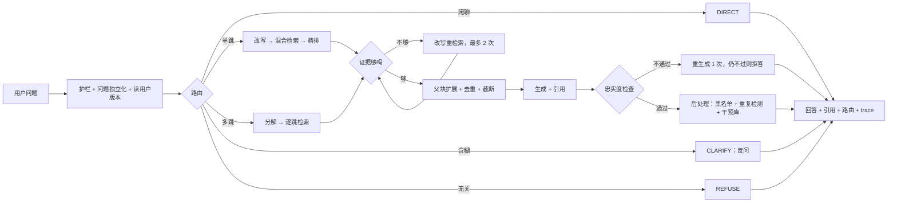

# 开发计划

> 怎么做：技术栈、设计、目录、评测方案、里程碑顺序。目标和非目标见 [GOALS.md](GOALS.md)，每个阶段的任务见 [harness/build/](harness/build/)，实际进度见 [harness/build-log.md](harness/build-log.md)。

## 1. 技术栈

| 类别 | 选型 |
|---|---|
| 语言 / 包管理 | Python 3.12、uv |
| 服务 | FastAPI（含 SSE）、MCP（官方 Python SDK） |
| 编排 | LangGraph |
| 存储 | PostgreSQL + pgvector（HNSW） |
| 稀疏检索 | bm25s + jieba3 中文分词（切词前保护变量名和术语；M2 与字符二元组对照） |
| 嵌入 | [Qwen3-Embedding-0.6B](https://huggingface.co/Qwen/Qwen3-Embedding-0.6B)（主选，2025-06）；对照 [bge-m3](https://huggingface.co/BAAI/bge-m3) |
| 精排 | [Qwen3-Reranker-0.6B](https://huggingface.co/Qwen/Qwen3-Reranker-0.6B)（主选，2025-06）；对照 [bge-reranker-v2-m3](https://huggingface.co/BAAI/bge-reranker-v2-m3) |
| 大模型 | DeepSeek `deepseek-flash`（V4.1-Flash，OpenAI 兼容 API，可替换） |
| 数据库访问 | SQLAlchemy 2（async，Core 风格）+ asyncpg + Alembic |
| 质量工具 | ruff、mypy、import-linter、pytest、pytest-asyncio、poethepoet |
| 交付 | Docker Compose |

- 嵌入与精排模型是开源权重，本机 GPU（RTX 5070 Ti 16GB）运行，不走 API。RTX 50 系（sm_120）需要 CUDA 12.8 及以上版本构建的 PyTorch。
- 只有 DeepSeek 走 API，密钥放 `.env`，不入库。

## 2. 数据集

来源：[langgenius/dify-docs `zh/`](https://github.com/langgenius/dify-docs/tree/main/zh)（CC BY 4.0）。

| 范围 | 篇数 |
|---|---|
| 自部署版：`self-host/use-dify` 94、`self-host/deploy` 14、`learn` 16、`api-reference/guides` 11、首页与快速开始 2 | 137 |
| 云版：`cloud/use-dify` 下 knowledge 23、workspace 12、monitor 10（体现版本差异） | 45 |
| **合计（全部入库）** | **182** |

- 文档**不放进仓库**：`backend/scripts/fetch_docs.py` 按固定 commit 下载到根目录 `data/raw/`（已 gitignore）。
- 固定 commit：`c80a31868611b673bd77725a6310c685068a585e`（2026-10-16 的 main），篇数已按此 commit 复核。
- 云版和自部署版的 `use-dify` 下有 92 个同名页面，是天然的版本差异题和检索难负例。
- 文档是 mdx，入库前去掉 JSX 组件；清洗规则见 [phase-01](harness/build/phase-01-ingest.md)。

## 3. 核心设计

### 3.1 RAG 流水线

| 环节 | 做法 | 对应问题 |
|---|---|---|
| 加载 | 读 mdx，去 JSX 组件，front matter 转元数据（标题、版本 edition、类别） | — |
| 分割 | 按 H2/H3 切并保留标题路径；父子块：子块约 300 字检索，父块（整节）给模型；代码块不拆；超长表格按行切分，每块重复表头 | 1、3 |
| 嵌入 | Qwen3-Embedding 对比 bge-m3，按 Recall@5 选 | 2 |
| 向量库 | pgvector，和元数据同库，可按 edition 过滤 | 6 |
| 检索 | BM25 与向量并行，RRF 融合；查询改写、多查询 | 1、2 |
| 精排 | Qwen3-Reranker 对比 bge-reranker-v2-m3 | 相似但不相关 |
| 上下文组装 | 子块扩展到父块，去重，按 token 预算截断 | 1 |
| 生成与校验 | 必须带引用；忠实度检查不过则重生成 1 次，仍不过则拒答 | 5 |

### 3.2 自适应编排

| 问题 | 做法 |
|---|---|
| 简单问题走重流程 | 路由：DIRECT / SINGLE / MULTI / CLARIFY / REFUSE（规则兜底 + LLM 分类） |
| 跨多篇 | 拆成子问题，逐个检索再合并 |
| 检索不到位 | 给证据打分，不够就改写重检索，最多 2 次 |
| 多轮指代、含糊 | 追问改写成完整问题；仍含糊就反问一次 |
| 版本差异 | 记住用户版本并过滤；未知时默认自部署版并注明 |
| 注入、超范围 | 输入护栏，直接 REFUSE |

### 3.3 流程



## 4. 后端

### 4.1 接口

- REST：`POST /chat`（支持 SSE）、`POST /retrieve`（只检索）、`POST /feedback`、`GET /health`
- MCP：`search_docs`、`ask_docs`

### 4.2 目录结构

```text
grounded_rag/
├── backend/
│   ├── app/                # Python 包，import app.xxx
│   │   ├── core/           # 配置、异常、通用类型
│   │   ├── providers/      # LLM / Embedding / Reranker 接口与实现（含离线假实现）
│   │   ├── db/             # 表定义、仓储
│   │   ├── ingest/         # 加载、清洗、切块、嵌入、增量入库
│   │   ├── retrieval/      # BM25、向量、RRF、精排、父块扩展
│   │   ├── memory/         # 会话窗口、摘要、用户版本
│   │   ├── graph/          # LangGraph 节点与图
│   │   ├── prompts/        # Prompt 文件（带版本号）
│   │   ├── reliability/    # 缓存、超时、重试、熔断、降级、限流
│   │   ├── observability/  # trace、成本
│   │   ├── api/            # FastAPI
│   │   └── mcp/            # MCP 服务
│   ├── tests/              # unit/、integration/
│   ├── eval/               # 评测器、指标、评审、报告
│   │   └── data/           # 开发集（只读）；测试集不在仓库
│   ├── scripts/            # 下载文档等一次性脚本
│   ├── migrations/         # Alembic 迁移（数据库表结构的版本记录）
│   ├── pyproject.toml
│   ├── uv.lock
│   └── Dockerfile
├── frontend/               # 不做（非目标）；将来需要时在此新建，有自己的工具链
├── harness/                # 阶段计划（build）、决策（context）、日志、review、归档
├── docs/                   # 只给人看的：评测手册、最终报告模板
├── docker-compose.yml
├── AGENTS.md  CLAUDE.md  GOALS.md  PLANS.md  PROMPTS.md  README.md  LICENSE
├── CODING-STANDARDS.md  WORKFLOW.md
├── data/                   # 下载的原始文档（gitignore）
└── .cache/                 # AI 生成的临时内容、模型与响应缓存（gitignore）
```

依赖方向见 [CODING-STANDARDS.md §3](CODING-STANDARDS.md)，由 import-linter 检查。目录在用到它的里程碑才建。

### 4.3 数据表（PostgreSQL + pgvector）

| 表 | 存什么 |
|---|---|
| documents / chunks | 文档、父子块、标题路径、edition、向量、内容哈希、语料版本 |
| conversations / messages / user_profiles | 会话、消息（含路由、引用）、用户版本 |
| traces | 每步输入输出、耗时、token、成本 |
| cache_entries | 向量、检索结果、LLM 响应三级缓存，按语料版本失效 |
| feedback / interventions | 用户反馈、坏例、人工钉住的标准答案 |
| eval_questions / eval_results | 评测题、每次评测结果 |

BM25 索引不入库，启动时从 chunks 表在内存构建。表在用到它的里程碑通过 Alembic 迁移创建，不一次建完。

## 5. 评测

### 5.1 四个核心指标

| 指标 | 怎么算 | 依据 |
|---|---|---|
| **可信得分**（总分） | 完全正确 +1、基本正确 +0.5、没答（拒答 / 反问）0、答错 −1，取平均；同时报正确率、幻觉率、拒答率。不可回答题：正确拒答或反问 +1，硬答 −1 | [CRAG](https://arxiv.org/abs/2406.04744) |
| **关键点召回** | 每题 2～4 个关键点，分 vital / okay；主指标是 vital 关键点被完整支持的比例；也是判“完全 / 基本正确”的依据 | [TREC 2024 RAG nugget 评测](https://arxiv.org/abs/2504.15068) |
| **Recall@5** | 金标文档是否进前 5；多跳题要求全部进入 | 经典检索指标 |
| **P95 延迟 / 每题成本** | 端到端耗时与 token 费用 | — |

错误归因只分两类：检索到的内容够却答错 → 生成问题；不够 → 检索问题（[Sufficient Context](https://arxiv.org/abs/2411.06037)）。

### 5.2 评测集：100 道

开发集 70（调参用），测试集 30（只在 M9 跑一次）。题型分层参考 [Know Your RAG](https://arxiv.org/abs/2411.19710)；不可回答题分类参考 [UAEval4RAG](https://arxiv.org/abs/2412.12300)；每类约一半用新手口吻（参考 [DataMorgana](https://arxiv.org/abs/2501.12789)）。

| 题型 | 题数 |
|---|---|
| 单篇事实 | 35 |
| 操作步骤 / 总结 | 15 |
| 跨篇推理（2～3 篇） | 20 |
| 版本差异 | 10 |
| 不可回答：文档没写 6、错误前提 4、含糊需反问 5、超范围 3、注入 2 | 20 |

每题字段和打分细则见 [评测笔记](harness/archive/2026-10-16/notes-evaluation.md) §7，M3 的 Spec 以它为准。

### 5.3 分工

| 环节 | 谁 | 规则 |
|---|---|---|
| 出题 | Gemini（作者在 Gemini 网页端操作，喂入清洗后的文档） | 产出问题 + 金标文档 + 关键点 + 期望路由，按 [notes-evaluation §7](harness/archive/2026-10-16/notes-evaluation.md) 的字段和配额 |
| 审题 | Claude（Opus） | 答案确在金标文档、无歧义、题干不泄漏答案；出题人和审题人不是同一个模型 |
| 人工确认 | 项目作者 | 100 道全看，只勾“能答 / 通顺” |
| 被测 | DeepSeek | 不参与出题和评审 |
| 评审 | Gemini 主评，Claude 复评 | 一致率约 85% 以上才采信；分歧题人工判；作者先人工标 20 条校准评审 |
| 开发 | Claude Sonnet（Claude Code），Codex 可选 | 不出题，看不到测试集 |

评审批量调用命令行，每批 10 题，只输出 JSON；结果缓存在 `.cache/`，中断可续跑。

### 5.4 对比实验

- 主线消融（每行报 4 个核心指标）：无检索 → naive RAG → + 混合检索与精排 → + 改写与自适应路由 → + 校验与拒答
- 模型对比（只看 Recall@5）：嵌入 2 选 1、精排 2 选 1
- 题量只有 100，差距很小不宣称提升，如实记录“没用”的项

## 6. 里程碑

| 阶段（Mx = phase-0x） | 内容 | 完成标准 |
|---|---|---|
| [M0](harness/build/phase-00-skeleton.md) | 骨架：目录、pyproject、Docker Compose（PostgreSQL + pgvector）、配置、providers 接口与假实现、poe 任务、CI | `uv run poe check` 通过；数据库能起 |
| [M1](harness/build/phase-01-ingest.md) | 数据管线：按固定 commit 下载、mdx 清洗、父子切块、元数据、嵌入、增量入库 | 182 篇入库；重复运行无重复块；输出数据报告 |
| [M2](harness/build/phase-02-retrieval.md) | 检索：BM25、向量、RRF、精排、版本过滤、父块扩展、`/retrieve`；模型对比 | 返回带分数的候选；选定模型 |
| [M3](harness/build/phase-03-evaluation.md) | 评测：评测集（100 题）、并行评测器、评审、报告 | `uv run poe eval-dev` 一条命令出报告 |
| [M4](harness/build/phase-04-baselines.md) | 基线：无检索、naive RAG | 两条基线入报告 |
| [M5](harness/build/phase-05-orchestration.md) | 编排：护栏、路由、改写、分解、证据评分与重检索、上下文组装、带引用生成、忠实度校验；Prompt 版本化 | 五路路由跑通；开发集与 naive 有对照 |
| [M6](harness/build/phase-06-memory.md) | 记忆：会话窗口与摘要、用户版本、token 预算 | 多轮追问与版本题答对 |
| [M7](harness/build/phase-07-service.md) | 服务与可靠性：REST + SSE、MCP、三级缓存、超时 / 重试 / 熔断 / 降级、限流、压测 | MCP 可被 Claude Code 调用；关掉精排仍能答；有 QPS 与 P95 |
| [M8](harness/build/phase-08-observability.md) | 观测与坏例：trace 与成本、输出后处理、反馈接口、干预库、坏例进回归集 | 任意回答可按 trace_id 复盘 |
| [M9](harness/build/phase-09-wrapup.md) | 收尾：测试集跑一次、完整消融、错误归因、README、一键复现 | 最终报告与可复现仓库 |

## 7. 开发方式

- 文档分工见 [AGENTS.md](AGENTS.md)；编码规则见 [CODING-STANDARDS.md](CODING-STANDARDS.md)，流程见 [WORKFLOW.md](WORKFLOW.md)，可复用的提示词见 [PROMPTS.md](PROMPTS.md)。
- 每个阶段：计划（`harness/build/phase-NN-*.md`）→ 实现 → 验证；重要决定记进 `harness/context/phase-NN-*-context.md`；实际做了什么、测试结果记进 `harness/build-log.md`。
- 测试集放在仓库外，只在 phase-09 由作者手动跑一次；评测数据与评测代码只读。
- 需要人工的地方：phase-01 看数据报告；phase-03 确认 100 道题；phase-09 看最终结果。

## 8. 待办与阻塞

> 代码都已完成（见 build-log）。下面是**没有被验证过**或**需要作者提供**的事，不要当成已经成立的结论。操作步骤见 [docs/eval/runbook.md](docs/eval/runbook.md)。

### 8.1 需要作者提供或操作（阻塞真实数字）

| 编号 | 事项 | 影响 | 怎么做 |
|---|---|---|---|
| A1 | 用 Gemini 出评测题（开发集 ~70、测试集 ~30） | 没有它，所有「效果」数字都出不来；phase-02 的模型对比只是 28 题冒烟集上的暂定结论 | [PROMPTS.md §6](PROMPTS.md)、[runbook](docs/eval/runbook.md) §1 |
| A2 | `DEEPSEEK_API_KEY` | 真实生成、真实 LLM 评审、真实路由 / 评分 / 校验的提示词效果、`/chat` 的真实延迟 | 写进 `.env` |
| A3 | 评审校准：人工标 20 条，一致率 ≥ 85% | 低于它，自动评审的结果不能用来比较方案 | [runbook](docs/eval/runbook.md) §3 |
| A4 | 测试集只跑一次 | 最终报告 | [runbook](docs/eval/runbook.md) §5 + [报告模板](docs/final-report-template.md) |
| A5 | 在 Claude Code 里注册 MCP 并试用；确认 `.claude/settings.json` 的 deny 规则（禁止编辑 `backend/eval/data/`）生效 | 只验证了 stdio 子进程能列工具，没在真实客户端里调用 | [runbook](docs/eval/runbook.md) §6 |
| A6 | 决定：版本未知时是否默认自部署版（现在是不过滤） | 版本类题的表现 | 见 [phase-05 决策](harness/context/phase-05-orchestration-context.md) |
| A7 | GitHub 合并 / CI 要求 | 目前所有提交都在 `2026-10-16-framework-build`，没有 PR、没合并 main | 作者说之后再说 |

没有这些时：把代码、假实现和测试做完，把阻塞写进 build-log 和最终报告，**不要停下来等**，接着做不依赖它们的任务。

### 8.2 代码层面没验证的

- 真实模型下：路由准确率、改写 / 分解 / 证据评分 / 忠实度校验的提示词效果。**提示词都是第一版**，要用开发集调；每次改动新增 `_v2` 文件，不要覆盖。
- 追问独立化、摘要的质量（没有多轮评测集）。
- 评审：Gemini 主评 + Claude 复评的双评审只支持 `claude -p` 命令行和 DeepSeek；本机没有 `gemini` 命令行。评审调用的费用没有计进报告的成本。
- 压测数字只测了假对话模型 + 真实检索：`/retrieve` 冷查询 QPS 4.8、P95 870 毫秒（精排在 GPU 上串行，是瓶颈）。
- HTTP 模式的 MCP（只验证了 stdio）；`traces` 表没有保留期清理。
- 日文版：只保留可行性（SudachiPy），没有做。

### 8.3 设计上的取舍（可以推翻）

- 黑名单默认空表（`app/orchestration/postprocess.py` 的 `BLOCKED_TERMS`）。
- 答案缓存键不含对话模型名，换模型后要重启服务。
- 限流只按 IP；没有鉴权。
- Contextual Retrieval 只做了免费简化版（标题路径拼进检索文本），大模型生成上下文留作备选，要看开发集的错误归因再决定。
