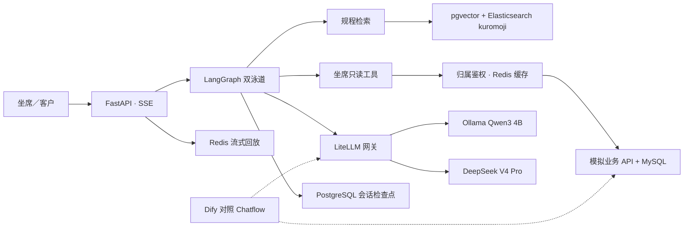

# grounded_rag

一个在 Mac 上运行的住宅贷款坐席 Copilot 概念验证。业务背景来自索尼银行的公开住宅贷款页面，客户、合同、还款与内部规程使用合成数据。坐席能通过只读工具查数并查阅日文规程。客户泳道只回答规程，个别合同查询引导转人工。

[本机实测报告](docs/eval/mac-poc-report.md) · [开发日志](harness/build-log.md) · [Dify 本机手册](docs/eval/dify-local.md)

## 架构



图中虚线为 Dify 对照的目标连接。Dify 已部署，画布导入和真实同题回放的进度见[阶段 37](harness/build/phase-37-dify-compare.md)。

## 用纯合成语料启动

适用于一个新克隆。需要 Python 3.12、uv 和 Docker Compose。若本机已有 Postgres 或其他同端口服务，先用 [.env.example](.env.example) 注释里的 Compose 端口覆盖值调开冲突，同时更新对应连接地址。

```bash
cp -n .env.example .env
docker compose up -d --build --wait db es redis mock_core
cd backend
UV_NO_CONFIG=1 uv sync --locked
UV_NO_CONFIG=1 uv run --locked alembic upgrade head
UV_NO_CONFIG=1 uv run --locked poe build-policies --as-of 2026-11-18 --synthetic-only --target-documents 12
EMBEDDING_MODEL=fake UV_NO_CONFIG=1 uv run --locked poe ingest
CHAT_MODEL=fake EMBEDDING_MODEL=fake RERANKER_MODEL=none UV_NO_CONFIG=1 uv run --locked poe serve
```

另开终端检索一份有版本的合成规程。编号可替换为 `HL-DEMO-ADDRESS` 查看另一条样例。

```bash
curl --fail --json '{"query":"HL-DEMO-DOCS 返済予定表の再発行","filter":{"corpus_tier":"S","as_of":"2026-11-18"}}' \
  http://127.0.0.1:8000/retrieve
curl --fail --json '{"question":"こんにちは。","channel":"customer"}' http://127.0.0.1:8000/chat
```

纯合成入口会写入当前目录的语料清单，已有公开层的环境请保留各自的入库配置。在 `backend/` 用 `uv run --locked --offline python -m scripts.copilot_regression` 跑固定假模型回归。

## 本机完整链路

1. 在根目录 `.env` 配置现有 `DEEPSEEK_API_KEY`、本机 `GATEWAY_API_KEY` 和 `EMBED_DEVICE=mps`。
2. 准备 Ollama 的 `qwen3:4b-instruct`，用 `OLLAMA_CONTEXT_LENGTH=4096 ollama serve` 启动。在仓库根目录运行 `docker compose up -d --build --wait`。
3. 在 `backend/` 用 `uv sync --locked --extra gpu` 加载本机推理依赖。如果全局 uv 配置限制了已锁定的包，在当前命令设置 `UV_NO_CONFIG=1`。
4. 按 [公开快照规则](PLANS.md#31-知识库语料) 用真实浏览器准备清单与快照，存到 `data/raw/public/`。依次执行 `uv run --locked alembic upgrade head`、`uv run --locked poe build-policies --as-of 2026-11-18`、`uv run --locked poe ingest` 和 `uv run --locked poe serve`。

本机生成和查询沿用同一 LiteLLM 网关、原有 DeepSeek 每日预算与计费记录。模拟系统的端点、归属样本和故障设置见 [mock_core 说明](mock_core/README.md)。公开页面原文只供本机使用，代码按 MIT 许可发布，合成材料由生成器在本机生成并标记。

## 接口

- `POST /retrieve` 用日期、语料档、商品和规程类型硬过滤。默认混合检索，精排可按请求开启。
- `POST /chat` 默认客户泳道。坐席请求带 `channel: "agent"`、`agent_id`、`customer_id`。会话连续时传同一 `session_id`。
- `POST /chat` 加 `stream: true` 开启 SSE。断开后用 `GET /chat/stream/{response_id}`、`Last-Event-ID` 续推。收到 `retract` 时用 `replacement` 替换已显示文本，最终 `answer` 为确定答复。
- `GET /traces/{trace_id}` 提供本机调试，`POST /feedback` 保存满意或不满意反馈。`uv run poe mcp` 提供与客户泳道共享的文档检索与问答。

## 检查与评测

在 `backend/` 执行以下命令。只在需要测试故障时显式打开两个本机调试开关。

```bash
uv run --locked poe check
MOCK_ALLOW_FAULT_HEADERS=true docker compose -f ../docker-compose.yml up -d --build --wait db es redis mock_core
uv run --locked poe test-int
uv run --locked python -m scripts.generate_copilot_cases generate
uv run --locked --offline python -m scripts.copilot_regression
```

真实合成开发回放、作者规程出题、校准与封存步骤见 [作者评测手册](docs/eval/copilot-author.md)。Dify 的部署、模型绑定和同题回放见 [Dify 本机手册](docs/eval/dify-local.md)。阶段验收、已知限制和交接记录在 [开发日志](harness/build-log.md)，历史实现见 [归档](harness/archive/v1-dify-docs/README.md)。
