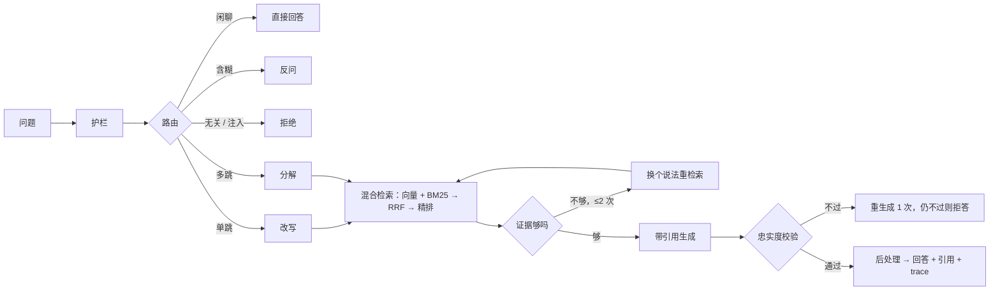

# grounded_rag

Dify 官方中文文档的问答后端（RAG）：按问题复杂度选择检索流程，答案带引用，文档里没有就拒答。对外提供 REST API 和 MCP。

> 状态：M0～M9 的代码都已完成（见 [build-log](harness/build-log.md)）。**真实模型下的效果数字还没有**：需要作者提供评测题和 DeepSeek 密钥，步骤见 [评测运行手册](docs/eval/runbook.md)；已知的缺口见 [PLANS.md §8](PLANS.md §8)。

## 它做什么



- 文档：Dify 中文文档 182 篇（自部署版 137、云版 45），固定 commit，不入库，按需下载。
- 检索：Qwen3-Embedding-0.6B + jieba3 分词的 BM25（bm25s）+ RRF + Qwen3-Reranker-0.6B，本机 GPU 推理；PostgreSQL + pgvector 存向量。
- 生成：DeepSeek（`deepseek-flash`），每天预算由代码强制。
- 可靠性：三级缓存、精排熔断与降级、生成不可用时返回检索片段、限流、启动预热。
- 观测：每次问答存 trace（`GET /traces/{id}`），反馈、干预库、坏例导出。

## 快速开始

需要：[uv](https://docs.astral.sh/uv/)、Docker、（本机推理需要 NVIDIA GPU；没有 GPU 时用 `EMBEDDING_MODEL=fake` 只能跑流程）。Python 3.12 由 uv 自动安装。

```bash
cp .env.example .env              # 本机 5432 被占用时，见 .env.example 里关于 DB_PORT 的说明
docker compose up -d db           # PostgreSQL 16 + pgvector

cd backend
uv sync --extra gpu               # 不要 GPU 推理就去掉 --extra gpu
uv run alembic upgrade head       # 迁移开发库
uv run poe fetch-docs             # 下载 182 篇文档到 data/raw/
uv run poe ingest                 # 清洗、切块、嵌入、入库
uv run poe check                  # 格式 + lint + 分层 + 类型 + 单元测试
uv run poe test-int               # 集成测试（自动建测试库 grounded_rag_test）
uv run poe serve                  # http://127.0.0.1:8000/docs，启动时预热模型
```

所有命令都在 `backend/` 下执行。问答需要在 `.env` 里写 `DEEPSEEK_API_KEY`（没有密钥时可以设 `CHAT_MODEL=fake` 只跑流程）。

## 接口

| 接口 | 说明 |
|---|---|
| `POST /chat` | 问答；`"stream": true` 时是 SSE（每个环节一个 `step` 事件，最后一个 `answer` 事件） |
| `POST /retrieve` | 只检索，返回每个候选在各环节的名次和分数 |
| `GET /traces/{trace_id}` | 复盘一次问答 |
| `POST /feedback` | 对某次回答打好 / 差评 |
| `GET /health` | 健康检查 |

MCP（stdio）：`claude mcp add grounded-rag -- uv run --directory <仓库>/backend poe mcp`，工具 `search_docs`、`ask_docs`。

## 评测

```bash
uv run poe eval-validate                      # 检查题目格式、金标文档是否在语料里
uv run poe eval-dev --system retrieval        # 只检索：Recall@5（不需要密钥）
uv run poe eval-dev --system full --judge deepseek   # 完整系统 + 评审（需要密钥和开发集）
uv run poe compare-retrieval                  # 9 种检索方案对比
uv run poe load-test --endpoint retrieve      # 压测（先 `poe serve`，并把 RATE_LIMIT_PER_MINUTE 设成 0）
```

评测题由作者用 Gemini 出，提示词在 [PROMPTS.md §6](PROMPTS.md)；完整步骤见 [评测运行手册](docs/eval/runbook.md)。

## 目录

```text
backend/    app/（业务代码）、tests/、eval/、scripts/、migrations/、pyproject.toml
harness/    阶段计划（build）、决策（context）、开发日志、review、归档
docs/       只给人看的：评测运行手册、最终报告模板
data/       下载的原始文档（gitignore）
.cache/     临时内容、模型缓存、评测输出（gitignore）
```

## 文档

| 想知道 | 看哪里 |
|---|---|
| 现在做到哪了、下一步 | [harness/build-log.md](harness/build-log.md) |
| 做什么、不做什么、成功条件 | [GOALS.md](GOALS.md) |
| 怎么做、里程碑顺序、没验证的 / 需要作者做的 | [PLANS.md](PLANS.md) |
| 每个阶段的范围、任务、验收 | [harness/build/](harness/build/) |
| 已定的决策、本机环境 | [harness/context/](harness/context/) |
| 代码、测试、接口、数据库规范 | [CODING-STANDARDS.md](CODING-STANDARDS.md) |
| 开发流程、Review | [WORKFLOW.md](WORKFLOW.md)、[PROMPTS.md](PROMPTS.md) |
| 历史日志和调研笔记 | [harness/archive/](harness/archive/README.md) |
| 怎么跑评测、出最终报告 | [docs/eval/runbook.md](docs/eval/runbook.md) |
| Agent 工作规则（Claude / Codex 通用） | [AGENTS.md](AGENTS.md) |

## 许可

代码：MIT。Dify 文档（不入库）：CC BY 4.0，来源 [langgenius/dify-docs](https://github.com/langgenius/dify-docs)。
