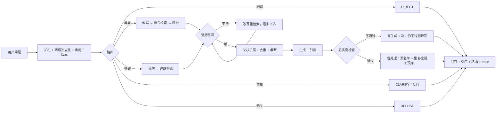

# grounded_rag 开发计划

> 软件使用手册的中文问答后端。按问题复杂度选择检索流程，答案带引用，文档里没有就拒答。
> 对外提供 REST API 和 MCP 工具。**只做 RAG**：不含 Agent runtime、多智能体、多模态。

## 1. 要解决的问题

以 Dify 官方中文文档为知识库，覆盖 RAG 最典型的 7 个问题：

1. 文档太长，关键信息被淹没（环境变量大全单篇约 126KB）
2. 用户口语和文档术语对不上（“把资料喂给机器人” vs “知识库”）
3. 一个问题要跨多篇文档才能答
4. 简单问题不该走重流程
5. 检索错了还自信地答
6. 版本差异（云版、自部署版同名页内容不同）
7. 问题含糊、多轮追问指代不明

**非目标**：前端界面、登录与多租户、SDK、模型微调、生产级高可用部署、Agent runtime / 多智能体 / 多模态。

## 2. 技术栈

| 类别 | 选型 |
|---|---|
| 语言 / 包管理 | Python 3.12、uv |
| 服务 | FastAPI（含 SSE）、MCP（官方 Python SDK） |
| 编排 | LangGraph |
| 存储 | PostgreSQL + pgvector（HNSW） |
| 稀疏检索 | rank_bm25 + jieba（加术语词典） |
| 嵌入 | [Qwen3-Embedding-0.6B](https://huggingface.co/Qwen/Qwen3-Embedding-0.6B)（主选，2025-06）；对照 [bge-m3](https://huggingface.co/BAAI/bge-m3) |
| 精排 | [Qwen3-Reranker-0.6B](https://huggingface.co/Qwen/Qwen3-Reranker-0.6B)（主选，2025-06）；对照 [bge-reranker-v2-m3](https://huggingface.co/BAAI/bge-reranker-v2-m3) |
| 大模型 | DeepSeek `deepseek-flash`（V4.1-Flash，OpenAI 兼容 API，可替换） |
| 数据库访问 | SQLAlchemy 2（async，Core 风格）+ asyncpg + Alembic |
| 质量工具 | ruff、mypy、import-linter、pytest、pytest-asyncio、poethepoet |
| 交付 | Docker Compose |

- 嵌入与精排模型是开源权重，本机 GPU（RTX 5070 Ti 16GB）运行，不走 API。RTX 50 系（sm_120）需要 CUDA 12.8 及以上版本构建的 PyTorch。
- 只有 DeepSeek 走 API，密钥放 `.env`，不入库。

## 3. 数据集

来源：[langgenius/dify-docs `zh/`](https://github.com/langgenius/dify-docs/tree/main/zh)（CC BY 4.0）。

| 范围 | 篇数 |
|---|---|
| 自部署版：`self-host/use-dify` 94、`self-host/deploy` 14、`learn` 16、`api-reference/guides` 11、首页与快速开始 2 | 137 |
| 云版：`cloud/use-dify` 下 knowledge 23、workspace 12、monitor 10（体现版本差异） | 45 |
| **合计（全部入库）** | **182** |

- 文档**不放进仓库**：`backend/scripts/fetch_docs.py` 按固定 commit 下载到根目录 `data/raw/`（已 gitignore）。
- 固定 commit：`c80a31868611b673bd77725a6310c685068a585e`（2026-10-16 的 main），篇数已按此 commit 复核。
- 云版和自部署版的 `use-dify` 下有 92 个同名页面，是天然的版本差异题和检索难负例。
- 文档是 mdx，入库前去掉 JSX 组件；清洗规则见 [M1 Spec](specs/M1-ingest.md)。

## 4. 核心设计

### 4.1 RAG 流水线

| 环节 | 做法 | 对应问题 |
|---|---|---|
| 加载 | 读 mdx，去 JSX 组件，front matter 转元数据（标题、版本 edition、类别） | — |
| 分割 | 按 H2/H3 切并保留标题路径；父子块：子块约 300 字检索，父块（整节）给模型；代码块不拆；超长表格按行切分，每块重复表头 | 1、3 |
| 嵌入 | Qwen3-Embedding 对比 bge-m3，按 Recall@5 选 | 2 |
| 向量库 | pgvector，和元数据同库，可按 edition 过滤 | 6 |
| 检索 | BM25 与向量并行，RRF 融合；查询改写、多查询 | 1、2 |
| 精排 | Qwen3-Reranker 对比 bge-reranker-v2-m3 | 相似但不相关 |
| 上下文组装 | 子块扩展到父块，去重，按 token 预算截断 | 1 |
| 生成与校验 | 必须带引用；忠实度检查不过则重生成 1 次，仍不过则拒答 | 5 |

### 4.2 自适应编排

| 问题 | 做法 |
|---|---|
| 简单问题走重流程 | 路由：DIRECT / SINGLE / MULTI / CLARIFY / REFUSE（规则兜底 + LLM 分类） |
| 跨多篇 | 拆成子问题，逐个检索再合并 |
| 检索不到位 | 给证据打分，不够就改写重检索，最多 2 次 |
| 多轮指代、含糊 | 追问改写成完整问题；仍含糊就反问一次 |
| 版本差异 | 记住用户版本并过滤；未知时默认自部署版并注明 |
| 注入、超范围 | 输入护栏，直接 REFUSE |

### 4.3 流程



## 5. 后端

### 5.1 接口

- REST：`POST /chat`（支持 SSE）、`POST /retrieve`（只检索）、`POST /feedback`、`GET /health`
- MCP：`search_docs`、`ask_docs`

### 5.2 目录结构

```text
grounded_rag/
├── backend/
│   ├── app/                # Python 包，import app.xxx
│   │   ├── core/           # 配置、异常、通用类型
│   │   ├── providers/      # LLM / Embedding / Reranker 接口与实现（含离线假实现）
│   │   ├── db/             # 表定义、仓储
│   │   ├── ingest/         # 加载、清洗、切块、嵌入、增量入库
│   │   ├── retrieval/      # BM25、向量、RRF、精排、父块扩展
│   │   ├── memory/         # 会话窗口、摘要、用户版本
│   │   ├── graph/          # LangGraph 节点与图
│   │   ├── prompts/        # Prompt 文件（带版本号）
│   │   ├── reliability/    # 缓存、超时、重试、熔断、降级、限流
│   │   ├── observability/  # trace、成本
│   │   ├── api/            # FastAPI
│   │   └── mcp/            # MCP 服务
│   ├── tests/              # unit/、integration/
│   ├── eval/               # 评测器、指标、评审、报告
│   │   └── data/           # 开发集（只读）；测试集不在仓库
│   ├── scripts/            # 下载文档等一次性脚本
│   ├── migrations/         # Alembic 迁移（数据库表结构的版本记录）
│   ├── pyproject.toml
│   ├── uv.lock
│   └── Dockerfile
├── frontend/               # 不做（非目标）；将来需要时在此新建，有自己的工具链
├── docs/                   # 计划、规范、Spec、决策
├── docker-compose.yml
├── AGENTS.md  README.md  LICENSE
├── data/                   # 下载的原始文档（gitignore）
└── .cache/                 # AI 生成的临时内容、模型与响应缓存（gitignore）
```

依赖方向见 [coding-standards.md §3](coding-standards.md)，由 import-linter 检查。目录在用到它的里程碑才建。

### 5.3 数据表（PostgreSQL + pgvector）

| 表 | 存什么 |
|---|---|
| documents / chunks | 文档、父子块、标题路径、edition、向量、内容哈希、语料版本 |
| conversations / messages / user_profiles | 会话、消息（含路由、引用）、用户版本 |
| traces | 每步输入输出、耗时、token、成本 |
| cache_entries | 向量、检索结果、LLM 响应三级缓存，按语料版本失效 |
| feedback / interventions | 用户反馈、坏例、人工钉住的标准答案 |
| eval_questions / eval_results | 评测题、每次评测结果 |

BM25 索引不入库，启动时从 chunks 表在内存构建。表在用到它的里程碑通过 Alembic 迁移创建，不一次建完。

## 6. 评测

### 6.1 四个核心指标

| 指标 | 怎么算 | 依据 |
|---|---|---|
| **可信得分**（总分） | 完全正确 +1、基本正确 +0.5、没答（拒答 / 反问）0、答错 −1，取平均；同时报正确率、幻觉率、拒答率。不可回答题：正确拒答或反问 +1，硬答 −1 | [CRAG](https://arxiv.org/abs/2406.04744) |
| **关键点召回** | 每题 2～4 个关键点，分 vital / okay；主指标是 vital 关键点被完整支持的比例；也是判“完全 / 基本正确”的依据 | [TREC 2024 RAG nugget 评测](https://arxiv.org/abs/2504.15068) |
| **Recall@5** | 金标文档是否进前 5；多跳题要求全部进入 | 经典检索指标 |
| **P95 延迟 / 每题成本** | 端到端耗时与 token 费用 | — |

错误归因只分两类：检索到的内容够却答错 → 生成问题；不够 → 检索问题（[Sufficient Context](https://arxiv.org/abs/2411.06037)）。

### 6.2 评测集：100 道

开发集 70（调参用），测试集 30（只在 M9 跑一次）。题型分层参考 [Know Your RAG](https://arxiv.org/abs/2411.19710)；不可回答题分类参考 [UAEval4RAG](https://arxiv.org/abs/2412.12300)；每类约一半用新手口吻（参考 [DataMorgana](https://arxiv.org/abs/2501.12789)）。

| 题型 | 题数 |
|---|---|
| 单篇事实 | 35 |
| 操作步骤 / 总结 | 15 |
| 跨篇推理（2～3 篇） | 20 |
| 版本差异 | 10 |
| 不可回答：文档没写 6、错误前提 4、含糊需反问 5、超范围 3、注入 2 | 20 |

每题字段和打分细则见 [评测笔记](implementation-log/2026-10-16/notes-evaluation.md) §7，M3 的 Spec 以它为准。

### 6.3 分工

| 环节 | 谁 | 规则 |
|---|---|---|
| 出题 | Claude（Claude Code） | 产出问题 + 金标文档 + 关键点 + 期望路由 |
| 审题 | Gemini（Cursor） | 答案确在金标文档、无歧义、题干不泄漏答案 |
| 人工确认 | 项目作者 | 100 道全看，只勾“能答 / 通顺” |
| 被测 | DeepSeek | 不参与出题和评审 |
| 评审 | Gemini 主评，Claude 复评 | 一致率约 85% 以上才采信；分歧题人工判；作者先人工标 20 条校准评审 |
| 开发 | Claude Sonnet（Claude Code），Codex 可选 | 不出题，看不到测试集 |

评审批量调用命令行，每批 10 题，只输出 JSON；结果缓存在 `.cache/`，中断可续跑。

### 6.4 对比实验

- 主线消融（每行报 4 个核心指标）：无检索 → naive RAG → + 混合检索与精排 → + 改写与自适应路由 → + 校验与拒答
- 模型对比（只看 Recall@5）：嵌入 2 选 1、精排 2 选 1
- 题量只有 100，差距很小不宣称提升，如实记录“没用”的项

## 7. 里程碑

| 编号 | 内容 | 完成标准 |
|---|---|---|
| M0 | 骨架：目录、pyproject、Docker Compose（PostgreSQL + pgvector）、配置、providers 接口与假实现、poe 任务、CI | `uv run poe check` 通过；数据库能起 |
| M1 | 数据管线：按固定 commit 下载、mdx 清洗、父子切块、元数据、嵌入、增量入库 | 182 篇入库；重复运行无重复块；输出数据报告 |
| M2 | 检索：BM25、向量、RRF、精排、版本过滤、父块扩展、`/retrieve`；模型对比 | 返回带分数的候选；选定模型 |
| M3 | 评测：评测集（100 题）、并行评测器、评审、报告 | `uv run poe eval-dev` 一条命令出报告 |
| M4 | 基线：无检索、naive RAG | 两条基线入报告 |
| M5 | 编排：护栏、路由、改写、分解、证据评分与重检索、上下文组装、带引用生成、忠实度校验；Prompt 版本化 | 五路路由跑通；开发集与 naive 有对照 |
| M6 | 记忆：会话窗口与摘要、用户版本、token 预算 | 多轮追问与版本题答对 |
| M7 | 服务与可靠性：REST + SSE、MCP、三级缓存、超时 / 重试 / 熔断 / 降级、限流、压测 | MCP 可被 Claude Code 调用；关掉精排仍能答；有 QPS 与 P95 |
| M8 | 观测与坏例：trace 与成本、输出后处理、反馈接口、干预库、坏例进回归集 | 任意回答可按 trace_id 复盘 |
| M9 | 收尾：测试集跑一次、完整消融、错误归因、README、一键复现 | 最终报告与可复现仓库 |

## 8. 开发方式

- 编码规则见 [coding-standards.md](coding-standards.md)，流程见 [workflow.md](workflow.md)，已定决策见 [decisions.md](decisions.md)。
- 每个里程碑：Spec（作者批准）→ Plan → Implement → Verify（作者合并 PR）；任务清单写在 `docs/specs/` 的 Spec 里。
- 测试集放在仓库外，只在 M9 由作者手动跑一次；评测数据与评测代码只读。
- 每天的开发过程记在 [implementation-log](implementation-log/README.md)；里程碑完成时在其 Spec 的「记录」里写总结。
- 需要人工的地方：M1 看数据报告；M3 确认 100 道题；M9 看最终结果。

## 9. 许可

- 代码：MIT（见 `LICENSE`）。
- Dify 文档：CC BY 4.0，不入库，README 注明来源。
- 评测集：改编自 Dify 文档，按 CC BY 4.0 发布并注明来源。
