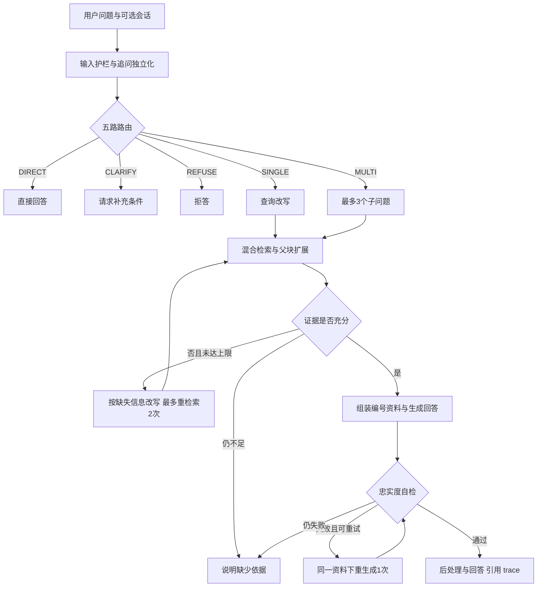

# grounded_rag 项目导学

核验日期：2026-10-21。grounded_rag源码基础为`44c8a064296bd891793c3a642f90ad32c23a6558`；对照本地Adaptive-rag版本`e10c84b8db1af5824fabf3c0b4e9e78f5f9b3b9c`。本材料依据当前源码和最终记录，早期计划只解释设计意图。未运行模型、系统或检索，未读取测试题干或回答。本文例子为教学假设，不是新增实验。

它是一个面向Dify官方中文文档的问答后端：根据问题选择处理路径，先找证据再回答，回答带出处，信息不足时补查、澄清或拒答。项目的工程目标是让回答能被核对、过程能被复盘、结果能被评测。

## 1. 前置知识

| 知识点 | 为何需要 | 项目位置 | 高频度 |
|---|---|---|---|
| RAG与模型参数知识 | 分清模型知道什么与本次资料支持什么 | `backend/app/prompts/generate_v1.md` | 高 |
| Embedding与向量最近邻 | 用语义找到措辞不同的段落 | `backend/app/providers/local_embedder.py`、`backend/app/db/corpus.py` | 高 |
| BM25、RRF、精排 | 分清词面召回、融合和相关性判断 | `backend/app/retrieval/` | 高 |
| 状态图和有界循环 | 根据问题分支，避免无限检索与生成 | `backend/app/orchestration/pipeline.py` | 高 |
| async、依赖注入、接口 | 理解服务装配与替换模型 | `backend/app/orchestration/factory.py`、`backend/app/providers/base.py` | 高 |
| 可回答与边界题 | 正确拒答和错误拒答的含义不同 | `backend/eval/scoring.py` | 高 |
| 缓存、熔断、降级 | 下游故障时保住可用的部分 | `backend/app/orchestration/service.py`、`backend/app/retrieval/resilient.py` | 高 |
| 置信区间与评审校准 | 避免把小样本和裁判偏差当成系统提升 | `backend/eval/scoring.py`、`harness/code_review/2026-10-20-judge-v2-author-calibration.md` | 高 |

## 2. 重点亮点与学习顺序

| 亮点标题 | 为什么重要 | 通用技术关键词 | 先看哪些文件 | 顺序 |
|---|---|---|---|---|
| 文档证据建模 | 文档切碎后仍要保留条件、版本与出处 | MDX清洗、父子块、内容哈希、元数据 | `backend/app/ingest/chunker.py`、`backend/app/db/tables.py` | 1 |
| 多阶段检索 | 语义近似与变量精确匹配需要配合 | BM25、Embedding、RRF、rerank | `backend/app/retrieval/retriever.py` | 2 |
| 自适应编排 | 不同问题需要不同成本与行为 | LangGraph、查询改写、分解、有限重试 | `backend/app/orchestration/pipeline.py` | 3 |
| 请求可靠性治理 | 模型故障不能只返回一个错误堆栈 | TTL、熔断、检索降级、SSE | `backend/app/orchestration/service.py` | 4 |
| 可验证评测 | 分数需要可追溯到原回答与评审依据 | nugget、独立评审、冻结、校准 | `backend/eval/scoring.py`、`backend/scripts/rejudge.py` | 5 |

## 3. 必备知识清单

- [ ] 能解释本项目服务谁、为什么选择Dify文档，而不是泛泛地说“做了一个聊天机器人”。
- [ ] 能分别说明小块召回、大块生成、混合召回、融合、精排各解决什么问题。
- [ ] 能画出五条路由，以及检索不足和生成不忠实的两种重试。
- [ ] 能区分业务流水线的自检与离线Claude裁判。
- [ ] 能解释严格成功率、宽松正确率、可信得分、Recall@5的不同分母。
- [ ] 能说明作者、AI编码工具、生成模型与评审模型各自承担什么工作。

## 4. 推荐阅读

| 主题 | 通用技术点 | 建议阅读位置 | 时间 | 读完能回答什么 |
|---|---|---|---|---|
| 项目范围 | 需求与非目标 | `GOALS.md`，再对照`harness/build-log.md`当前状态 | 10分钟 | 做什么，不承诺什么 |
| 数据管线 | 清洗、切分、增量写库 | `backend/app/ingest/pipeline.py` → `cleaner.py` → `chunker.py` → `backend/app/db/tables.py` | 30分钟 | 一篇MDX如何变成可检索证据 |
| 检索链 | 召回、融合、精排、父块扩展 | `backend/app/retrieval/retriever.py` → `fusion.py` → `tokenizer.py` → `backend/app/db/corpus.py` | 30分钟 | 找到相关资料用了哪些步骤 |
| 问答链 | 图节点和终止条件 | `backend/app/orchestration/pipeline.py` → `backend/app/prompts/` → `backend/app/orchestration/context.py` | 40分钟 | 一道问题如何走到最终回答 |
| 对外服务 | 装配、缓存、降级、流式事件 | `backend/app/api/main.py` → `services.py` → `backend/app/orchestration/factory.py` → `service.py` → `backend/app/api/chat.py` | 30分钟 | API与核心算法如何分工 |
| 评测 | 缓存作答、裁判标签、固定换分 | `backend/scripts/eval_run.py` → `backend/eval/systems.py` → `runner.py` → `judge.py` → `scoring.py` → `report.py` | 40分钟 | 一条命令怎样产出报告 |
| 结果可信性 | 只重评、完整翻转、作者裁决 | `backend/scripts/rejudge.py`、`audit_rejudge.py`、`harness/code_review/2026-10-20-judge-v2-author-calibration.md` | 25分钟 | 为什么改裁判不能叫系统变强 |

## 5. 自学提醒

若某文件或原理看不懂，请继续追问AI；本技能负责给学习路径与题目，不提供逐行讲解。建议先沿一条真实调用链读通，再逐个展开局部函数。先理解输入、输出和失败行为，再背技术名词。

## 6. 项目技术定位与背景

定位：AI应用后端工程。它把检索增强生成、状态图编排、数据库、接口、观测和评测连接起来。没有训练基础模型，没有实现通用Agent运行时，也没有生产用户量或上线业务收益证据。

选择Dify文档的理由很具体：文档长且有代码/表格；用户说法与术语不同；答案可能跨多个功能；云版与自部署版有同名页面；部分问题缺少条件或文档根本没有答案。固定公开语料还让每个结论可以回到原文核验。项目并不是Dify本身，也不依赖Dify工作流执行问答。

### 与本地Adaptive-RAG的关系

这是两个本地仓库在当前版本的功能与实现比较，不能仅凭比较断言具体代码的原创比例或复制历史。

| 维度 | 本地Adaptive-RAG | grounded_rag |
|---|---|---|
| 业务对象 | 电商客服政策、订单与物流操作 | Dify中文产品文档问答 |
| 共同思想 | LangGraph路由、改写/多跳、混合检索、精排、自纠错、记忆 | 延续这些思想并重新围绕文档证据组织 |
| 五条路径 | DIRECT/SINGLE/MULTI/AGENT/REFUSE | DIRECT/SINGLE/MULTI/CLARIFY/REFUSE |
| 复杂能力 | 规划器、执行器、工具权限、高风险写操作确认 | 最多3个检索子问题、证据充分性判断、缺失信息补查 |
| 存储 | 默认SQLite与内存组件，可接Qdrant/Redis | PostgreSQL+pgvector、内存BM25与TTL缓存 |
| 文档建模 | 客服知识检索 | 固定Dify语料commit、MDX结构切分、父子块、版本过滤 |
| 对外形式 | Web工作台、CLI、HTTP、业务工具 | REST、阶段SSE、MCP的文档查询与问答工具 |
| 评测着力点 | 本地仓库自己的意图/检索/生成实验 | 70dev+20reg+30test、要点评分、边界行为、缓存重评、作者校准、哈希审计 |

路由、RRF、精排、自纠错在参考仓库中已经存在，不能写成后来独立发明。更能体现本项目工作的地方是：把任务收敛到文档证据，补上版本与结构处理，以及可以追溯的评测闭环。没有订单取消、人工确认、前端工作台或任意工具执行能力。

## 7. 核心原理解析

### 7.1 离线准备：把文档变成可定位证据

主链：下载固定commit → 清洗MDX → 提取标题/版本/类别 → 结构切块 → 本地嵌入 → 事务写库 → 启动时构建BM25索引。

本机核验记录为182篇、1252父块、2090子块；Qwen3与bge-m3各存2090条向量，主链使用Qwen3。不能把两种模型的向量数相加说成4180个不同知识片段。

父块按H2/H3及结构边界组织，父块配置上限4000字符；子块目标300、通常上限500字符，代码与超长结构有专门切分规则，不能声称每个子块都严格500字符。标题路径同时用于检索和引用定位。小块更易精确命中，命中后展开父块，给模型补回条件与上下文。代价是父块更占上下文，需要去重与截断。

文档哈希由原始字节与入库版本共同生成：内容没变则不重复清洗和嵌入，规则变更可通过入库版本触发重建。文档、父子块和向量保存在同一个PostgreSQL，外键和事务保证关系完整。pgvector负责1024维向量的余弦近邻，HNSW负责近似搜索；BM25从子块在进程内构建，并非另一个数据库服务。

### 7.2 在线检索：找到“语义相关而且真的能回答”的证据

1. 查询嵌入由本地Qwen3-Embedding-0.6B产生，查询加Dify检索指令，文档不加。
2. 向量搜索与BM25搜索并发，各召回前30个子块。中文用jieba3，变量名和术语先保护，防止精确标识被切碎。
3. RRF按两个榜单的名次融合去重：每个候选累计`1/(60+名次)`，不直接把BM25分数与余弦距离相加。
4. 融合前20送入本地Qwen3-Reranker-0.6B，重新判断查询与文本的相关性；最后取5个子块。
5. 根据父块ID展开、去重，作为上下文候选。指定cloud/self_host时，同时保留common文档。

例如用户说“把资料喂给机器人”，向量负责语义联系；用户明确给出某环境变量，BM25负责精确词面。融合让两类候选都有机会，精排再压低“词像但问题不对”的结果。当前真实消融不足，不能断言这套组合比单向量提高了多少个百分点。

注意：多子问题在当前流水线中逐个检索，合并时按出现顺序积累父块与文档；没有把所有轮次重新做一次全局精排。它也没有把前一个子问题的生成答案动态填入下一个子问题，因此更适合描述为“分解式跨篇检索”。

### 7.3 自适应编排：先决定怎么处理，再花检索与模型成本

LangGraph保存当前状态并执行显式边与条件边；各节点是异步Python函数。它不是多个自治模型互相讨论。路由、改写、证据判断、生成与在线校验通常都调用同一个DeepSeek接口，节点多不等于模型多。

- DIRECT主要处理问候和能力介绍。短问候有规则捷径，其余由模型分类。
- SINGLE把一个明确问题改写后检索。
- MULTI分解后逐个检索，再合并证据。
- CLARIFY用于缺少重要条件的问题。
- REFUSE处理注入或超出范围；检索后发现资料不够，也可保留原路由但`abstained=true`。所以路由字符串不等于最终行为是否正确。

证据充分性回答的是“这些材料够不够回答问题”；忠实度校验回答的是“已经生成的说法有没有超出材料”。二者对应检索遗漏与生成越界，不能相互替代。自检仍可能判断错误：当前grade/verify遇到无法解析的JSON会按通过处理，属于需认识的实现边界，不能说成强制事实证明。

### 7.4 上下文、引用与多轮记忆

父块去重后编号，生成提示词要求事实后标`[编号]`。资料组装使用约12000字符的字数预算，编号解析删除不存在的引用并返回被使用的文档与标题。它不保证每个引用真的充分支持对应声明；“编号合法”与“内容有据”仍是两件事。

有session_id时从PostgreSQL读会话。先把“那云版呢”等追问改写成完整问题，再进入路由和检索。超过6轮触发早期历史摘要，最近3轮保留原文，格式化历史预算3000字符。这不是128k token动态压缩系统，也没有长期向量记忆或跨用户个性化学习。

实现优先使用请求指定edition，其次会话edition，再尝试从路由输出提取。都没有时检索不强制过滤版本，生成规则要求区分云版与自部署差异。早期PLANS写的“未知默认自部署”不是当前源码行为。

### 7.5 请求可靠性与观测

对外调用链：REST或MCP → 共用服务装配 → 问答服务 → 状态图 → 检索/模型/数据库。API负责输入校验、限流、序列化，业务流程和模型实现分别下沉。

| 能力 | 当前实现与边界 |
|---|---|
| 三级缓存 | 查询向量2000条/1小时，检索结果500条/10分钟，完整回答200条/10分钟；都是进程内TTL缓存，不是Redis或数据库持久缓存 |
| 会话缓存隔离 | 有session_id的完整回答不缓存，避免把相同字面问题套用到不同历史 |
| 精排熔断 | 连续3次失败打开，30秒后单次半开探测；失败则尝试不精排检索，标degraded，降级结果不缓存 |
| 生成故障 | API服务层整次流水线超时90秒；模型不可用、预算不足或超时后尝试返回相关文档片段。数据库/嵌入也坏时不保证降级成功 |
| 模型调用 | 单次HTTP超时60秒，可重试错误最多重试2次，等待按1、2秒线性增加；不是指数退避加抖动 |
| SSE | 每完成节点推step，最终推完整answer；当前不是逐token打字输出 |
| MCP | search_docs与ask_docs复用服务；已验证stdio，不将HTTP传输当成验证完成 |
| 观测 | 本地trace存步骤、候选、上下文、输出、耗时、估算费用；Langfuse可选云端副本 |
| 反馈与干预 | 好差评、导出坏例、人工固定答复；不会根据反馈自动训练或自动修改知识库 |

回答缓存键包括问题、edition和提示词版本，没有语料commit。运行期热更新语料的完整失效机制还不能算解决，不能照抄PLANS里“全部按语料版本失效”的设计承诺。

## 8. 关键设计决策

| 备选 | 选择与取舍 | 风险 | 如何验证 |
|---|---|---|---|
| 所有输入固定RAG流程 | 按五路选择路径，明确补查次数 | 路由错会影响后续证据 | 看实际route、steps与最终行为，分开计数 |
| 所有文档等长硬切 | 按结构父子切分，兼顾命中与上下文 | 父块大导致截断或噪声 | 查看命中子块、父块与实际generate.context |
| 只用向量 | 语义与词面并行、RRF后精排 | 更多推理成本，未必每种题都增益 | 用已有基线入口在同题同评审下对比；本次不追加实验 |
| 一直重检索 | 最多额外2次，证据仍不足就拒答 | 某些可答题被错拒 | 查看missing与拒答数量，避免只展示答对的题 |
| 在线模型自评作最终成绩 | 离线Claude标签+固定Python规则+作者参考校准 | 裁判仍有偏差，非盲复核有锚定风险 | 冻结样本、原标签、双向翻转和作者裁决 |
| 改裁判后重跑整个系统 | 冻结原回答，只重评缓存 | 缓存资料可能不等于最终截断后的完整输入 | 保留生成步骤与缓存父块，明确两者差别 |

## 9. 评测技术、实测结果与解释

### 9.1 评测对象与流程

三套为新dev70、旧reg20、test30，共120题，分开报告。可回答题分别56、16、24；边界题分别14、4、6。题集覆盖事实、归纳、跨篇、版本，以及拒答、澄清、纠正前提。题目附代表金标、必答点和等价来源，不以整篇参考答案字符串匹配判对错。

实际链路：冻结题集 → 系统作答并保存answers.jsonl → Claude CLI读取题目/要点/证据/回答给JSON标签 → Python固定换分 → 汇总报告与置信区间 → 样本作者复核。首次命令一次完成跑系统与打分；rejudge则只读缓存，不重跑系统、不重新检索。

本轮full入口直接构造ChatPipeline+真实检索器，不经过API的ChatService，也没有会话store。因此120题验证的是单轮完整问答流水线，不能把它称为HTTP负载测试、多轮记忆评测或所有缓存/容错场景的真实验收。相关工程机制另有单元/集成测试。

模型裁判只给nuggets、contradiction、behavior、corrects_premise、covers_interpretations五类字段。最终分数由只读评分代码计算，避免把裁判自由给出的一个“85分”当标准。关键点分support/partial_support/not_support，必答点用vital标记。

原子事实评分的思想与TREC RAG nugget工作一致，但本项目是工程适配，不是复现整套论文：[The Great Nugget Recall](https://arxiv.org/abs/2504.15068)。可信得分借鉴CRAG对可信回答的关注，具体规则以本项目代码为准，并非直接运行其官方数据集：[CRAG](https://arxiv.org/abs/2406.04744)。

### 9.2 指标与分母

| 指标 | 本项目实际定义 |
|---|---|
| 严格成功率 | 可回答题中，全部vital完整表达且无contradiction的题数/可回答题数 |
| 宽松正确率（含部分） | 可回答题中perfect或acceptable的比例；答了一部分也可能计入 |
| 可信得分 | 全部题平均points：可答题完全+1、部分+0.5、未答0、错误−1；边界行为正确+1，否则−1 |
| Recall@5 | 只看有金标的可答题，前5篇文档中所有必需证据组都至少命中一篇；组间AND、组内OR |
| 必答点完整覆盖V_strict | 可答题的vital完整覆盖比例做宏平均；不等于整题严格成功率 |
| 边界处理可接受率 | 各边界题按拒答、澄清/覆盖解释、纠正前提判断，不只比route字符串 |

Recall@5是项目定义的文档级全证据组命中率，不是前5个chunk的相关比例。多查询、多轮返回文档按当前流水线顺序积累，不是全局重排后的5篇。可信得分区间是固定种子0、bootstrap1000次得到的均值95%区间。

### 9.3 本轮v2结果

| 题集 | 作答/评审完成 | 严格成功率 | 宽松正确率 | 可信得分与95%区间 | Recall@5 |
|---|---|---|---|---|---|
| dev70 | 70/70、70/70 | 38/56＝67.86% | 46/56＝82.14% | +0.729［+0.600,+0.836］ | 38/56＝67.86% |
| reg20 | 20/20、20/20 | 14/16＝87.50% | 14/16＝87.50% | +0.900［+0.750,+1.000］ | 14/16＝87.50% |
| test30 | 30/30、30/30 | 23/24＝95.83% | 23/24＝95.83% | +0.833［+0.633,+1.000］ | 21/24＝87.50% |

dev的必答点完整覆盖79.17%，边界可接受12/14＝85.71%；reg分别87.50%与4/4＝100%；test分别95.83%与4/6＝66.67%。所以“test可答题23/24成功”不能解释成“30题全部成功”。test有两道边界题未达到行为判据：23道可答满分、1道未答0分、4道边界+1和2道−1，合计25/30＝0.833。

当前三套作答和评审错误均0；曾发生的18条Claude限额错误保留在历史，不伪装为从未失败。

### 9.4 为什么有v1与v2，以及90%是什么

v1只看代表金标文档，可能把系统从其他检索资料得到的真实补充误判成无依据。v2加入缓存父块作为判断依据，也保留了作者批准的“完整表达关键点不因附加谨慎措辞降级”规则。因此要单列nugget变化，不能把所有分差都归因于新增contexts。

同一批原回答不变，v1→v2的dev严格62.50%→67.86%、可信+0.557→+0.729；reg严格68.75%→87.50%、可信+0.750→+0.900；test保持不变。这是换评审后的判定变化，不是系统检索或生成变强。

v2评审资料总长上限24000字符，含截断标记，缺资料有明确占位。它读的是缓存检索父块，可比生成时12000字符预算下的输入更宽。故v2有据判定也不能直接充当“每条说法均被实际生成上下文支持”的逐声明忠实率。

固定种子20261021抽20条dev/reg，作者看过预标与Claude标签后完成复核；五字段整题18/20＝90%，超过约定17/20门槛。方法为非盲标，存在锚定风险；原Codex预标16/20＝80%保留。这90%是评审与作者参考一致，不是RAG答题正确率。原标签未用人工参考回填修改。

### 9.5 延迟、成本与剩余证据边界

| 题集 | 本轮作答P95 | 平均估算模型API费用/题 |
|---|---|---|
| dev70 | 36.118秒 | ¥0.0372 |
| reg20 | 64.456秒 | ¥0.0459 |
| test30 | 27.191秒 | ¥0.0408 |

这些是首次系统作答记录，v2只重评所以没有新的系统时延。原运行并发默认4，每套先3题试跑再续跑，重建检索器/加载模型开销保留在部分题记录中。不是稳定暖机后的在线服务P95或QPS；费用是代码按冻结价格估算的被测方模型API费用，不含Claude评审、GPU、电力或全部实验成本。

最近完整质量检查463 passed、35 deselected，覆盖率94.93%，说明相应自动检查通过，不等于线上可用率或业务正确率。原Windows审计82保护文件与6冻结实现哈希精确匹配，证明过程未篡改相关文件，不证明模型语义全对。

已经实现无检索、朴素RAG、混合精排、路由、完整系统这些实验入口，仍缺这120题在统一v2口径下完整消融的对照证据。E/F/C（最终证据覆盖、逐声明有据、有效引用覆盖）有设计契约，通用结构化自动汇总尚未完成。不能借别的项目数字填补这些缺口。

测试题由开发agent参与编写，不能称严格开发者盲测。样本小且题集分布不同，test高于dev不表示泛化超过开发，也不能与Adaptive-RAG的客服评测分数直接比较。

## 10. 理解后怎样准备简历

先能讲清四件事：一是业务问题为何需要证据约束；二是父子块和混合精排如何把资料找出来；三是路由、补查、自检和拒答如何控制流程；四是裁判为什么也需要校准与审计。

候选表述是“在AI辅助下完成Dify文档问答后端，采用结构化父子切块、混合检索与有界状态图编排，并建立120题分组评测、缓存重评与作者样本复核”。是否使用“主导”“独立实现”以及个人负责模块，须根据本人能解释和举证的实际参与再确定。大部分代码由AI辅助编写，不能直接冒领为全部手写。

面试展开与候选bullet见同目录`面经-grounded-rag.md`。当前完整成果适合写架构机制和可复核结果；不要写未验证的高并发、线上用户、零幻觉、生产高可用、性能提升百分比或独立盲测。
